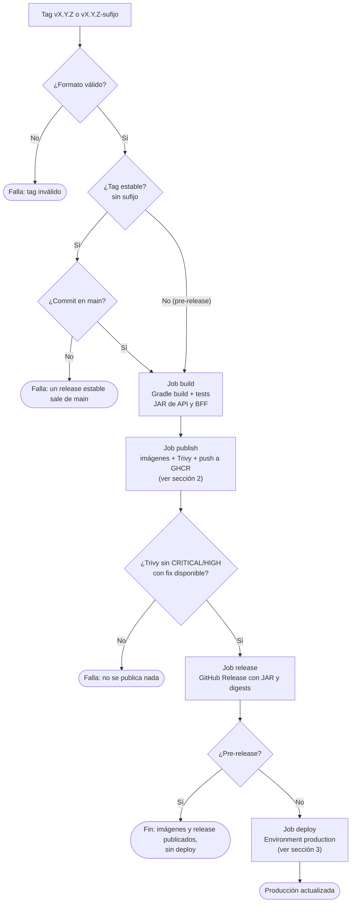
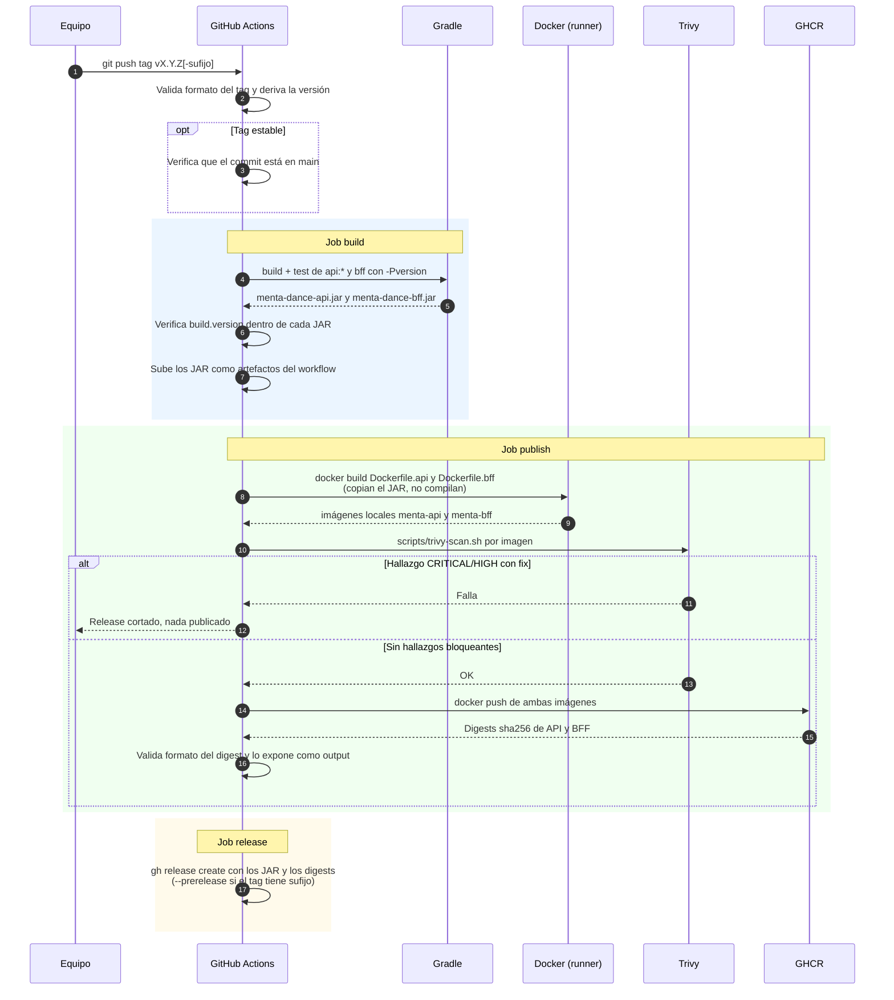
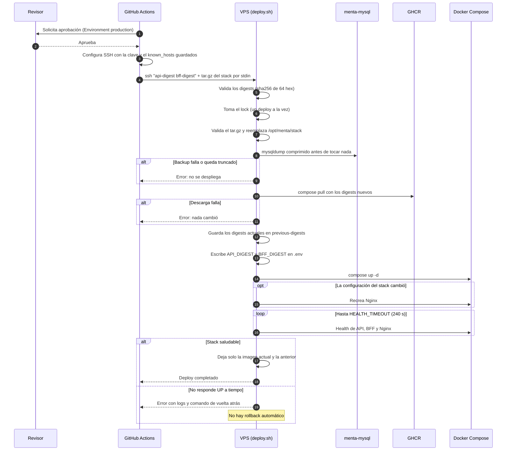
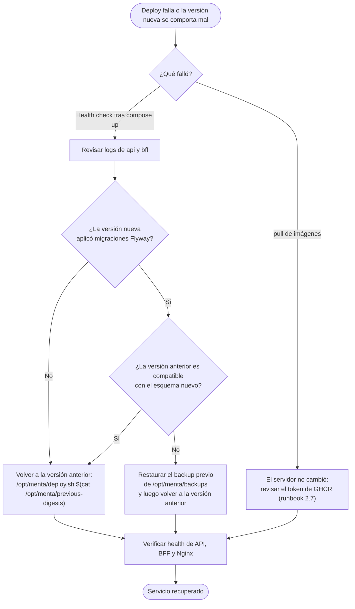

# Diagramas de Release y Deploy

Cómo una imagen llega a producción: desde el tag hasta el stack corriendo en el VPS. Sintaxis Mermaid.

Fuentes: `.github/workflows/release.yml` (#592), `infra/docker/prod/deploy.sh` (#593), ADR-0018 y ADR-0045. El procedimiento en el servidor está en [`32-VPS-DONWEB-RUNBOOK.md`](../32-VPS-DONWEB-RUNBOOK.md) y el pipeline en [`16-CICD-PIPELINE.md`](../16-CICD-PIPELINE.md).

## Índice

1. [Visión general del release](#1-visión-general-del-release)
2. [Construcción y publicación de las imágenes](#2-construcción-y-publicación-de-las-imágenes)
3. [Deploy en el VPS](#3-deploy-en-el-vps)
4. [Vuelta atrás manual](#4-vuelta-atrás-manual)

---

## 1. Visión general del release

Un tag `vX.Y.Z[-sufijo]` dispara `release.yml`. Los JAR se construyen una sola vez y las imágenes solo los copian: lo que se escanea, se publica y se despliega es el mismo artefacto. El deploy referencia las imágenes por digest, nunca por tag.

Un tag con sufijo (`v0.2.0-rc.2`) publica las imágenes y un GitHub Release marcado como pre-release, pero **no despliega**. Un tag estable solo se acepta si su commit ya está en `main`.

El workflow corre con `concurrency: production` y `cancel-in-progress: false`: un solo release a la vez y ninguno se cancela a mitad, porque un deploy interrumpido deja el VPS a medias.

---

## 2. Construcción y publicación de las imágenes

El escaneo de Trivy ocurre **antes** del push a GHCR. Si el gate falla, el job termina ahí y el registro queda sin la imagen.

---

## 3. Deploy en el VPS

Solo corre con un tag estable. El Environment `production` guarda los secretos de deploy y, si se configura, exige una aprobación antes de que el job arranque.

La clave SSH del workflow tiene un `command=` forzado en `authorized_keys`: lo único que puede ejecutar es `/opt/menta/deploy.sh`. Los digests llegan al script en `SSH_ORIGINAL_COMMAND` y la configuración del stack (compose, `nginx.conf`, `conf.d`) por la entrada estándar como `tar.gz`, de modo que el servidor siempre usa la configuración del tag que se despliega.

Qué protege cada paso:

| Paso | Riesgo que cubre |
|---|---|
| Digest en lugar de tag | El tag es mutable; el digest identifica exactamente lo que se escaneó |
| `command=` forzado en la clave | Una clave filtrada solo puede lanzar `deploy.sh`, no una shell |
| Validación de digests y del `tar.gz` | Lo único que viaja desde afuera no llega a ningún comando sin validar |
| `mysqldump` previo | Flyway solo avanza: el backup es la única vuelta atrás de los datos |
| `pull` antes de modificar `.env` | Si la descarga falla, el estado del servidor no cambia |
| Lock con `flock` | Dos deploys simultáneos no se pisan |

---

## 4. Vuelta atrás manual

`deploy.sh` no revierte solo. La base de datos no se puede deshacer automáticamente (Flyway no tiene rollback), así que quién opera decide.

Al volver atrás, `deploy.sh` usa la configuración del stack ya instalada (sin entrada estándar) y las imágenes anteriores siguen en el servidor, porque el script conserva la actual y la anterior.
