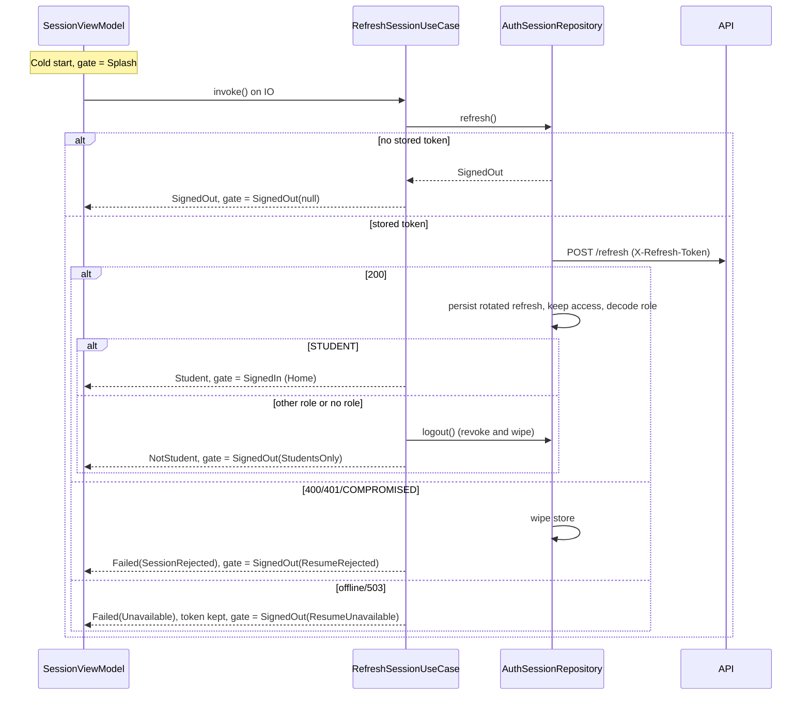
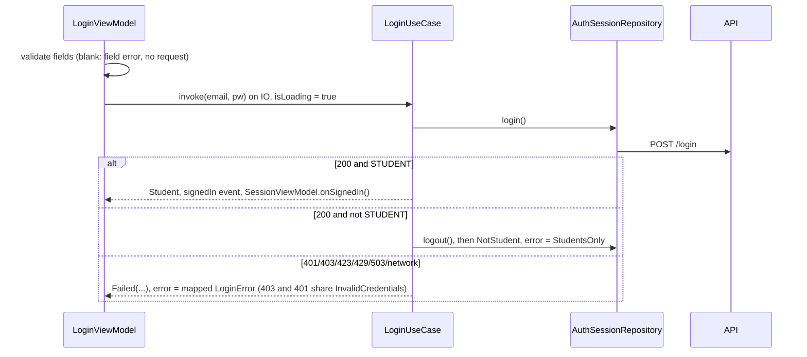
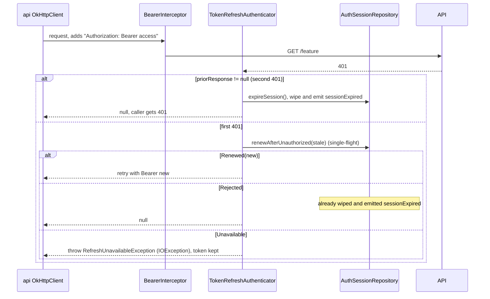
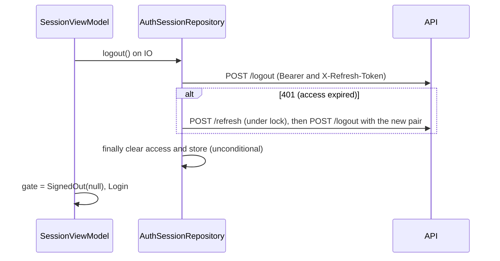

# Design: Android Login and Authenticated Navigation (#374)

## Technical Approach

Replace the `HttpURLConnection` adapter with **OkHttp 5 + kotlinx.serialization** (no Retrofit). Two OkHttp clients share one connection pool: a plain `auth` client for `/api/v1/auth/*` and an `api` client that adds a Bearer interceptor and a refresh `Authenticator`. `AuthSessionRepository` stays the single owner of the access token (memory) and the refresh token (Keystore store). It becomes **thread-safe and single-flight**: one JVM lock serializes login, refresh, logout and 401 renewal, and shares the outcome of each refresh attempt. The role comes from the unverified `role` JWT claim, decoded in the data layer. The domain gains a sealed `AuthFailure`, a `Role` and a student gate in the use cases. Presentation is one activity with a root Navigation Compose `NavHost`, driven by an activity-scoped `SessionViewModel` state machine (Splash / SignedOut(notice) / SignedIn). Blocking repository calls run on an injected IO dispatcher. Every decision maps to the specs `android-auth-navigation` and `android-authenticated-http`. D1-D4 are honoured as locked.

Verified facts this design relies on:
- `JwtService.issue` emits a single `role` claim plus `sub`, `jti`, `iat`, `exp` and `tokenVersion`. There is no name or email claim.
- The token body contains `access_token`, `token_type` and `expires_in`. `expires_in` is a JSON number such as `900.0`.
- `/auth/logout` requires an authenticated Bearer token (`SecurityConfig`), so an expired access token yields 401.
- There is **no Gradle dependency locking** (no `*.lockfile` and no `dependencyLocking`). The "dependency locking" line in `openspec/config.yaml` is out of date. ADR-0024 requires exact pinned versions.
- `android` has no JaCoCo gate: it appears in neither `moduleCoverageFloor` nor `jvmCoverageModules`.

## Architecture Decisions

### ADR-1: HTTP client

| Option | Tradeoff | Decision |
|---|---|---|
| Keep `HttpURLConnection` | Zero dependencies, consistent with #82. A hand-written retry/bearer layer is needed. Android's implementation can silently replay a POST on a stale connection. On the JVM, tests need a hand-rolled server, and `org.json` is a stub in unit tests, which is why `HttpAuthRemoteDataSource` has no test today | Rejected |
| **OkHttp 5 (no Retrofit)** | `Interceptor` and `Authenticator` match AC5 exactly. `retryOnConnectionFailure(false)` gives explicit control over replaying `/refresh`. `mockwebserver3` gives real wire tests on the JVM. Cost: OkHttp and Okio (about 1 MB; minify is off), and the remote adapter must be migrated | **Chosen** |
| OkHttp + Retrofit | Declarative endpoints. Today there are 3 auth endpoints and no feature endpoint, so it adds a converter and an annotation layer for no benefit. #375+ can adopt it on top of the same `api` client without rework | Deferred to #375+ |

JSON: use **kotlinx.serialization** (the `org.jetbrains.kotlin.plugin.serialization` plugin at the catalog `kotlin` version, plus `kotlinx-serialization-json`). It replaces `org.json` and works in JVM unit tests (the token response DTOs, problem+json and the JWT payload). Rejected alternative: keep `org.json` and add `testImplementation("org.json:json")`. That splits runtime and test behaviour and creates two JSON stacks once #375 arrives. Base64url uses the Kotlin stdlib `kotlin.io.encoding.Base64.UrlSafe` (absent padding allowed). `android.util.Base64` is a stub on the JVM, and `java.util.Base64` needs API 26 while minSdk is 24.

Gotcha: `expires_in` arrives as `900.0`. Declare it as `Double` and convert, because decoding it as a `Long` fails.

### ADR-2: Single-flight refresh (blocking lock, not a coroutine Mutex)

| Option | Tradeoff | Decision |
|---|---|---|
| Coroutine `Mutex`/`Deferred` | Idiomatic for suspend code, but OkHttp's `Authenticator` is synchronous on OkHttp threads, so it would need `runBlocking` | Rejected |
| **`synchronized` lock + attempt generation + stale-token compare** | Works the same from OkHttp threads and from `Dispatchers.IO`. Waiters reuse the outcome of the attempt that finished while they waited, which is equivalent to sharing a `Deferred` | **Chosen** |

```kotlin
// AuthSessionRepository (data). All mutation happens under `lock`. accessToken is @Volatile.
fun renewAfterUnauthorized(stale: String): Renewal {
    val seen = generation                                // volatile read before blocking
    synchronized(lock) {
        if (generation != seen) return lastRenewal       // an attempt finished while we waited: reuse it
        accessToken?.takeIf { it != stale }?.let { return Renewal.Renewed(it) } // already renewed
        return performRefreshLocked().also { generation++; lastRenewal = it }
    }
}
```

Rules:
- `login`, `refresh` (cold start), `logout` and `renewAfterUnauthorized` all take the same lock, so a rotation can never overlap another one.
- The rotated refresh token is persisted **before** the new access token is kept, and the session fails closed if persisting fails (existing #82 behaviour).
- The `auth` client sets `retryOnConnectionFailure(false)`. A transparent replay of a `/refresh` that the server already processed would be a reuse, which triggers `REFRESH_TOKEN_COMPROMISED` and revokes every session.
- Refresh classification: `401`, `REFRESH_TOKEN_COMPROMISED` or `400 INVALID_AUTH_REQUEST` (a malformed stored token) is a **rejection**. Its handling: wipe locally, then `Renewal.Rejected`. A network error, `503`/`AUTH_DEGRADED` or anything else means **unavailable**: keep the token, then `Renewal.Unavailable` (D2).
- **Logout retry**: if `logout` returns 401 (the access token expired), renew once under the lock and repeat logout with the new pair. Local wipe in `finally` is unconditional. Without this, a logout made more than 15 minutes after the last refresh would leave the server-side refresh token valid for 7 days, which breaks AC4.
- **Session-expired signal (D4)**: `SessionRepository.sessionExpired: Flow<Unit>` is backed by `MutableSharedFlow(extraBufferCapacity = 1, DROP_OLDEST)`. It is emitted after a local wipe caused by a second 401 or by a rejected renewal. `SessionViewModel` collects it.

### ADR-3: Domain model and JWT decoding

| Option | Tradeoff | Decision |
|---|---|---|
| Keep `AuthFailure(code: String)` | Presentation would have to switch on wire strings, and it cannot express the distinct NotActivated case cleanly | Rejected |
| **Sealed `AuthFailure` mapped from the problem `code` in the data layer** | Exhaustive `when` in the UI. The wire format stays in data. Clients discriminate by `code`, as the OpenAPI document requires | **Chosen** |
| Role check in a ViewModel | Not reusable between login and cold start | Rejected: the student gate lives in the domain use cases |

The JWT decoder is `data/remote/JwtRoleReader`, a mirror of BFF `JwtAccessTokenClaimsReader`: a compact JWT with 3 parts, a Base64url payload, a textual `role` matching `[A-Z][A-Z_]*`, mapped to the `Role` enum. Any failure gives `null`, which the domain treats as non-STUDENT. **The signature is not verified.** The role is UX gating only, and the API authorizes every call. Tokens never reach logs, exception messages or `toString()`. No `HttpLoggingInterceptor` is installed.

### ADR-4: Navigation and state machine

| Option | Tradeoff | Decision |
|---|---|---|
| Top-level `when(state)` with a NavHost only for authenticated screens | Simple gate, but `hiltViewModel()` outside a NavHost is activity-scoped, so the login form state would survive logout | Rejected |
| **One root `NavHost` (Splash, Login, Authenticated graph { Home }) driven by `SessionGate`** | Each destination gets its own ViewModel store, which resets cleanly. The gate navigates with `popUpTo(graph){inclusive}` and `launchSingleTop`, so Back on Home exits the app | **Chosen** |
| Navigation 3 | Newer API, but AC3 names Navigation Compose, and the ecosystem and Hilt integration are less mature | Rejected |

- Routes are type-safe `@Serializable` objects, reusing the ADR-1 serialization plugin.
- Splash is a Compose destination. `core-splashscreen` is not needed.
- D1: on login, a non-student stays on Login with a `StudentsOnly` error. On cold start, the gate goes to `SignedOut(StudentsOnly)`. Both revoke and wipe through `logout()`. There is no dedicated "role rejected" screen.
- D3: the authenticated scaffold has a top bar with a drawer that lists the `StudentSection` entries (only `Home` today) plus "Cerrar sesión". Home shows a generic greeting, because the JWT carries no name.
- Dispatchers: `di/DispatchersModule` provides `@IoDispatcher CoroutineDispatcher`. ViewModels call `withContext(io)`. Tests inject a `StandardTestDispatcher`.
- Placeholder removal: `StaticWelcomeRepository`, `WelcomeRepository`, `WelcomeMessage`, `GetWelcomeMessageUseCase`, `MainViewModel`, `MainUiState`, `MainScreen`, `AndroidBindingsModule` and `AndroidSmokeTest`.

## Data Flow









## File Changes

`M/` = `android/src/main/java/com/menta/android/`, `T/` = `android/src/test/java/com/menta/android/`.

| File | Action | Description |
|---|---|---|
| `gradle/libs.versions.toml` | Modify | Add `okhttp`, `mockwebserver3` (sharing one `okhttp` version.ref), `kotlinx-serialization-json`, `kotlinx-coroutines-android`/`-test`, `navigation-compose`, the `hiltViewModel()` artifact, and the plugin `kotlin-serialization` |
| `build.gradle.kts` (root) | Modify | `alias(libs.plugins.kotlin.serialization) apply false` |
| `android/build.gradle.kts` | Modify | Apply the serialization plugin. Add `implementation` for okhttp, serialization-json, coroutines-android, navigation-compose and the hilt compose VM artifact. Add `testImplementation` for mockwebserver3 and coroutines-test |
| `M/data/remote/OkHttpAuthRemoteDataSource.kt` | Create | Replaces the HttpURLConnection adapter. Same contract. Parses problem+json `code`, `Retry-After` and 204 |
| `M/data/remote/HttpAuthRemoteDataSource.kt` | Delete | Superseded |
| `M/data/remote/AuthWireModels.kt` | Create | `@Serializable` LoginRequest, TokenResponse (`expires_in: Double`) and Problem |
| `M/data/remote/AuthRemoteDataSource.kt` | Modify | `Problem` gains `status: Int` |
| `M/data/remote/JwtRoleReader.kt` | Create | Unverified `role` decode, returns `Role?` |
| `M/data/remote/BearerTokenInterceptor.kt`, `TokenRefreshAuthenticator.kt` | Create | AC5. The authenticator also defines `RefreshUnavailableException` |
| `M/data/session/AccessTokenSource.kt` | Create | Data-internal port: `currentAccessToken()`, `renewAfterUnauthorized()`, `expireSession()`, `Renewal` |
| `M/data/repository/AuthSessionRepository.kt` | Modify | Lock, generation, role, failure mapping, wipe rules, logout retry, `sessionExpired`. Implements `AccessTokenSource` |
| `M/domain/model/AuthFailure.kt` | Modify | Sealed (see Interfaces) |
| `M/domain/model/SessionState.kt` | Modify | `Authenticated(expiresInSeconds, role: Role?)` |
| `M/domain/model/Role.kt`, `StudentSessionResult.kt` | Create | Domain types |
| `M/domain/repository/SessionRepository.kt` | Modify | Add `sessionExpired: Flow<Unit>` |
| `M/domain/usecase/LoginUseCase.kt`, `RefreshSessionUseCase.kt` | Modify | Return `StudentSessionResult` and apply the student gate (non-student triggers `logout()`) |
| `M/domain/usecase/ObserveSessionExpiryUseCase.kt` | Create | Exposes `sessionExpired` |
| `M/di/AndroidAuthModule.kt` | Modify | Bind the repository as `SessionRepository` and `AccessTokenSource`, using the `@AuthHttpClient` client |
| `M/di/NetworkModule.kt` | Create | `@AuthHttpClient` (10 s timeouts, no connection-failure retry, no logging) and `@ApiHttpClient` (`newBuilder` + interceptor + authenticator) |
| `M/di/DispatchersModule.kt` | Create | `@IoDispatcher` |
| `M/presentation/session/SessionViewModel.kt`, `SessionGate.kt` | Create | Gate state machine, logout, expiry collection |
| `M/presentation/login/LoginViewModel.kt`, `LoginUiState.kt`, `LoginError.kt`, `LoginScreen.kt` | Create | Form, loading, the `AuthFailure.toLoginError()` mapping, and the screen |
| `M/presentation/splash/SplashScreen.kt`, `M/presentation/home/HomeScreen.kt` | Create | Splash progress indicator; greeting |
| `M/presentation/navigation/Routes.kt`, `MentaNavHost.kt`, `AuthenticatedScaffold.kt` | Create | Root graph, gate-driven navigation, drawer menu |
| `M/MainActivity.kt` | Modify | `setContent { MentaDanceTheme { MentaNavHost() } }` |
| `android/src/main/res/values/strings.xml` | Modify | Spanish copy (see Open Questions) |
| Placeholder files (ADR-4 list), `M/di/AndroidBindingsModule.kt`, `T/AndroidSmokeTest.kt` | Delete | AC7 |
| `T/data/remote/OkHttpAuthRemoteDataSourceTest.kt`, `JwtRoleReaderTest.kt`, `AuthenticatedClientTest.kt` | Create | MockWebServer and pure JVM tests |
| `T/data/repository/AuthSessionRepositoryTest.kt` | Modify | New mapping and wipe rules |
| `T/data/repository/AuthSessionRepositoryConcurrencyTest.kt` | Create | Single-flight |
| `T/domain/usecase/LoginUseCaseTest.kt`, `RefreshSessionUseCaseTest.kt` | Create | Student gate |
| `T/presentation/login/LoginViewModelTest.kt`, `T/presentation/session/SessionViewModelTest.kt` | Create | The ViewModel tests required by the issue |
| `T/testing/MainDispatcherRule.kt`, `T/architecture/DomainPurityTest.kt` | Create | `Dispatchers.setMain` rule; a source scan asserting no `android.`/`androidx.` imports under `domain/` (there is no ArchUnit for Android) |

## Interfaces / Contracts

```kotlin
enum class Role { ADMIN, INSTRUCTOR, STUDENT, RECEPTIONIST }

sealed interface AuthFailure {
    data object InvalidCredentials : AuthFailure          // 401 INVALID_CREDENTIALS
    data object AccountNotActivated : AuthFailure         // 403: same UI text as InvalidCredentials
    data object AccountLocked : AuthFailure               // 423 USER_LOCKED
    data class RateLimited(val retryAfterSeconds: Long?) : AuthFailure // 429
    data object Unavailable : AuthFailure                 // network, 503 AUTH_DEGRADED
    data object SessionRejected : AuthFailure             // refresh 400/401/COMPROMISED; store already wiped
    data object InvalidResponse : AuthFailure
    data object LocalStorageFailed : AuthFailure
    data class Unexpected(val code: String) : AuthFailure // stable API code only, never detail or token
}

sealed interface StudentSessionResult {
    data object Student : StudentSessionResult
    data object NotStudent : StudentSessionResult        // revoked and wiped before returning
    data object SignedOut : StudentSessionResult
    data class Failed(val failure: AuthFailure) : StudentSessionResult
}

sealed interface SessionGate {                           // presentation
    data object Splash : SessionGate
    data class SignedOut(val notice: SessionNotice?) : SessionGate
    data object SignedIn : SessionGate
}
enum class SessionNotice { SessionExpired, ResumeRejected, ResumeUnavailable, StudentsOnly }
```

## Dependencies (exact pins chosen at apply time)

This phase had no network access, so the floors below were not verified against Maven Central or Google Maven. Apply MUST pin the **latest stable exact** version that is compatible with Kotlin 2.4.20, AGP 9.4.1, compileSdk 37 and minSdk 24 (ADR-0024).

| Library | Floor | Dependabot group |
|---|---|---|
| `com.squareup.okhttp3:okhttp` and `mockwebserver3` (one `okhttp` ref) | 5.1.0 | `gradle-minor-patch`; majors arrive as a separate PR |
| `org.jetbrains.kotlinx:kotlinx-serialization-json`, `kotlinx-coroutines-*` | the release built for Kotlin 2.4.x; coroutines aligned with what lifecycle 2.9.3 resolves | `android-build-tooling` (matches `org.jetbrains.kotlin*`, so it moves with the compiler) |
| `androidx.navigation:navigation-compose` | 2.9.x | `androidx-libraries` |
| `hiltViewModel()` host (`androidx.hilt:hilt-lifecycle-viewmodel-compose` 1.3.x, formerly `hilt-navigation-compose`) | 1.3.x | `androidx-libraries` |

## Testing Strategy

| Layer | What to test | Approach |
|---|---|---|
| Unit (pure) | `JwtRoleReader` (valid, missing, lowercase, malformed, 2 parts); domain gate (student, non-student calls `logout`, null role); `AuthFailure` to `LoginError` (NotActivated equals InvalidCredentials) | JUnit 4 and fakes |
| Unit (repository) | Code and status mapping; refresh wipe on 400/401/COMPROMISED and keep on offline/503; persist-before-access; logout retry on 401; unconditional wipe; `sessionExpired` emission | Fake remote and store (existing pattern) |
| Unit (concurrency) | Two threads calling `renewAfterUnauthorized` on the same stale token make **one** remote refresh and both receive the new token; a stale token with a newer one held makes no refresh; a rejected outcome is shared | `CountDownLatch` plus a fake remote that blocks until both threads enter |
| JVM wire | Remote adapter: headers, body, problem+json, `Retry-After`, 204, `900.0`. Authenticated client: Bearer added; 401, then refresh, then retry; 403/500 cause no refresh; persistent 401 expires the session; unavailable throws `IOException`; two parallel 401s produce exactly one `/refresh` hit | `mockwebserver3` with a counting `Dispatcher` |
| ViewModel | Login ok, invalid credentials, blank fields, loading flag, non-student; cold start (Student goes to SignedIn, SignedOut, Rejected, Unavailable, NotStudent); logout; expiry goes to SessionExpired | `MainDispatcherRule` + `StandardTestDispatcher` injected as `@IoDispatcher`, with fake use-case dependencies |
| Not unit-tested | Compose rendering, NavHost back stack, Keystore (the existing androidTest is compiled but not executed, per ADR-0036), cleartext debug config, Hilt graph (KSP validates it at `assembleDebug`) | Manual emulator check against `10.0.2.2:8081` with the `demo` profile: `alumno@` login, then kill and relaunch (resume); wrong password; `profesor@`/`recepcion@` show the notice; airplane-mode cold start shows the notice and a later relaunch resumes; logout, then a Bruno refresh with the old token is rejected; Back on Home exits; 6 or more failures produce 429. Locked and pending accounts need DB setup. Mid-use expiry is covered by unit tests only, because no screen makes authenticated calls yet |

Robolectric and Compose UI tests on the JVM were rejected: heavy tooling, and not required by AC validation.

## Slicing (auto-chain, 800 authored lines per slice)

| # | Slice | Contents | Est. lines |
|---|---|---|---|
| 1 | Wire migration | Dependencies; OkHttp/serialization adapter + MockWebServer tests; `Problem.status`; `NetworkModule` `@AuthHttpClient` | ~450 |
| 2 | Session model | Sealed `AuthFailure`, `Role`, `SessionState.role`, `JwtRoleReader`, repository mapping and refresh wipe rules, tests, `DomainPurityTest` | ~450 |
| 3 | Authenticated HTTP | Lock/generation single-flight, `AccessTokenSource`, interceptor, authenticator, logout retry, `sessionExpired`, `@ApiHttpClient`, concurrency and MockWebServer tests | ~600 |
| 4 | Login flow | Gated use cases, dispatchers, `LoginViewModel`/screen/errors/strings, root `NavHost` with Login and a minimal Home, `MainActivity`, navigation dependencies | ~700 |
| 5 | Session shell | Splash, `SessionViewModel` gate (cold start, logout, expiry), drawer menu, placeholder deletion (about 180 deleted lines) | ~700 |

Slices 1 and 2 may merge if slice 1 measures under 350 lines. Each slice compiles and passes `./gradlew :android:testDebugUnitTest :android:assembleDebug`.

## Threat Matrix

N/A: no CLI routing, shell, subprocess, VCS/PR automation, executable-file classification or process-integration boundary. Token secrecy is covered by ADR-2/3 and its tests.

## Migration / Rollout

No migration required. The Keystore format and alias are unchanged. Revert slice PRs in reverse order.

## Open Questions

- [x] **User: Spanish copy and register — RESOLVED (voseo, like the rest of the repo).** Final copy:
  - "Email o contraseña incorrectos." (also used for the not-activated case)
  - "Tu cuenta está bloqueada."
  - "Demasiados intentos. Volvé a intentarlo en %d segundos."
  - "El servicio no está disponible. Intentalo más tarde."
  - "Esta app es para alumnos."
  - "Tu sesión expiró. Ingresá de nuevo."
  - "No pudimos restaurar tu sesión." (rejected)
  - "Sin conexión: ingresá cuando vuelvas a estar en línea." (unavailable)
- [x] **User: greeting — RESOLVED:** the JWT has no name or email and there is no `/me` endpoint, so Home shows a generic "¡Hola!" (accepted by the user). Personalising it is a future change that needs a backend claim or endpoint.
- [x] **User: ADR — RESOLVED:** no ADR. The design (this file) and the PR description carry the justification for adding OkHttp + kotlinx.serialization to the ADR-0024 baseline. Revisit an ADR if Retrofit or an app-wide networking policy is added later.
- [x] **Spec alignment — RESOLVED:** `400 INVALID_AUTH_REQUEST` on refresh is treated as a rejection (wipe); both specs now list it.
- [ ] **Follow-ups (out of scope):** the OpenAPI `bearerAuth` description says `roles`, `iss` and `aud`, but the real token has `role` and no `iss`/`aud`. `openspec/config.yaml` claims dependency locking that does not exist.
